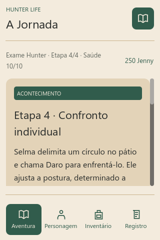
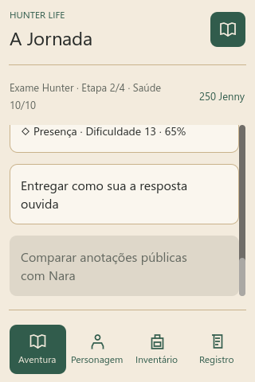
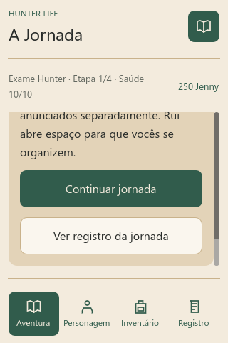

# Etapa 10A — Revisão narrativa

## Escopo e resultado

Revisão editorial dos **58 acontecimentos existentes**, de todas as escolhas e de suas variantes de sucesso e fracasso, no projeto Hunter Life em Godot 4.7.2. Permanecem os mesmos IDs, a mesma ordem de opções, as mesmas aventuras e os mesmos resultados mecânicos. Não foram adicionados acontecimentos, Hatsus ou sistemas. O Bloco 10B não foi iniciado.

A escrita agora apresenta circunstâncias concretas antes das escolhas: quem solicita ajuda, o que está em jogo, quais meios estão disponíveis e o que acontece depois da decisão. Os personagens continuam originais. Foram removidas explicações sobre a estrutura do jogo de dentro da narrativa, como referências a nível mínimo, necessidades diárias simuladas e ausência de batalha obrigatória.

## Acontecimentos revisados

| Núcleo | IDs preservados e revisados |
|---|---|
| Oportunidades iniciais | `market`, `tournament`, `cart`, `traveler`, `notice` |
| Entrega da Serra | `offer`, `route`, `bridge`, `delivery`, `end_path`, `end_home`, `end_duty` |
| Levantamento da Trilha | `survey_offer`, `survey_path`, `survey_find`, `survey_done` |
| Trabalho e pausas | `dock`, `rain`, `merchant_return`, `crossroads` |
| Encerramentos | `journey_path`, `journey_home`, `journey_duty` |
| Fundamentos de Nen | `nen_offer`, `nen_ten`, `nen_zetsu`, `nen_ren`, `nen_water`, `nen_done` |
| Hatsus e aplicações existentes | `develop_reinforce`, `develop_emission`, `blocked_passage`, `signal_roof` |
| Confrontos existentes | `battle_bandit`, `battle_fighter` |
| Suprimentos e ferramentas | `supply_stall`, `workshop_objects`, `abandoned_pack`, `dark_store` |
| Inscrição e apresentação | `exam_invite`, `exam_info`, `exam_arrival`, `exam_candidates` |
| Oito provas | `exam_crossing`, `exam_endurance`, `exam_inquiry`, `exam_capture`, `exam_survival`, `exam_team`, `exam_duel`, `exam_judgment` |
| Intervalos | `exam_interval_1`, `exam_interval_2`, `exam_interval_3` |
| Resultados e licença | `exam_pass`, `exam_fail`, `exam_withdraw`, `licensed_contract` |

Os três encerramentos da entrega e os três finais de jornada deixaram de compartilhar explicações genéricas: cada um destaca uma direção diferente para o personagem. As práticas de Hatsu descrevem resultados próprios para Potência, Resistência, Alcance e Precisão, inclusive quando o exercício requer orientação adicional. Compras, serviços e ferramentas receberam consequências específicas para o objeto e a situação.

Nos acontecimentos repetíveis `tournament` e `dock`, a prosa não promete valores fixos que poderiam contradizer a redução de recompensas em visitas posteriores. O valor efetivamente aplicado continua aparecendo no resumo de recursos já existente.

## Exame Hunter — prioridade da revisão

### Regras efetivamente apresentadas

Escolher ouvir as regras em `exam_arrival` agora apresenta as quatro fases, a diferença entre advertências e condutas eliminatórias, a tolerância de até duas advertências na avaliação final e a possibilidade de desistência. O texto não se limita a informar que o personagem ouviu uma explicação.

Cada prova tem local, objetivo e examinador identificados. As consequências narradas correspondem aos efeitos existentes:

| Prova | Clareza acrescentada |
|---|---|
| Travessia perigosa | Marco de chegada, trecho sinalizado, desvio permitido, ancoragem de corda e atraso ao ajudar Nara. Ten evita o ferimento daquela alternativa, mas não a advertência por atraso. |
| Percurso de resistência | Ritmo sustentado, marcas autorizadas, desvio do mapa e orientação de Ivo conforme o acordo anterior. Arrancadas e esforço mal dosado têm fracassos distintos. |
| Investigação | Conclusão justificada, comparação permitida de pistas públicas e proibição explícita de copiar uma resposta como própria. As falhas descrevem a pressa, queda e atraso correspondentes à perda de Saúde e advertência já existentes. |
| Captura | Fita em suporte móvel, pontos de interceptação e pequena trava como alvo apropriado. A diferença entre antecipar, correr, usar Zetsu e mirar com Precisão fica explícita. |
| Sobrevivência | Posto de chegada, acesso escuro, referências de água e situação de Nara. A opção de ceder bandagem informa que consome uma unidade; a omissão de socorro e seu efeito sobre a cooperação estão contextualizados. |
| Desafio coletivo | Sustentação dos apoios, funções do grupo e proibição de sabotagem. Ren pode causar recuo e desorganização; a força ampliada ainda depende de apoio correto. |
| Confronto individual | Vitória ou desistência do adversário com até duas advertências; rendição avaliada após um turno resolvido, ajuda anterior a Nara e no máximo uma advertência. Fuga, rendição fora dessas condições e incapacidade têm consequências explicadas antes da luta. |
| Prova de decisão | Material irregular, devolução com justificativa, proposta alternativa sujeita à aceitação e fraude. A conferência das advertências é mencionada mesmo quando a solução final foi aceita. |

Selma mantém a fala direta e a atenção às justificativas; Rui acompanha execução e segurança. Nara oferece cooperação sem exigir aliança permanente; Daro enfatiza competição e desempenho próprio; Ivo prioriza regras, referências e economia de esforço. As reações dependem das condições e flags que já existiam, sem inventar relações novas.

Os intervalos agora descrevem pausas diferentes e cuidados com os próprios suprimentos, em vez de instruir o jogador a abrir a aba Inventário. Aprovação, reprovação e desistência apresentam despedidas distintas. A licença é narrada como credencial recebida, sem comentários sobre atributos máximos ou funcionalidades futuras.

## Preservação técnica e salvamentos

Foi registrada, antes da edição, uma assinatura SHA-256 de todo o catálogo com exclusão apenas dos campos editoriais `title`, `chapter`, `paragraphs`, `label` e `result`. O teste `test_narrative_revision.gd` confirma que a assinatura permanece:

```text
40382126e730e18a104797296c6eb6aa5312f0c4c9efa65965df004d29a9c258
```

Isso preserva IDs, pesos, condições, testes, dificuldades, recompensas, custos, dano, cura, flags, itens, encadeamentos, batalhas, repetição e regras do exame. Os títulos e capítulos também foram mantidos nesta revisão, embora sejam campos editoriais permitidos pelo teste. As escolhas mudaram somente em texto, mantendo índices e requisitos.

A única alteração no código de produção foi a frase de apresentação em `scripts/exam.gd`: “até duas podem ser recuperadas” passou a “a avaliação final admite até duas”. A contagem não diminui nem é recuperada mecanicamente; a nova redação descreve o comportamento real.

O salvamento continua **v9**, sem novos campos ou migração adicional. As migrações anteriores permanecem intactas. Históricos e resultados já resolvidos são carregados como foram gravados, sem reescrita retroativa ou reaplicação de efeitos. Descrições dos acontecimentos ainda abertos usam o catálogo revisado. A seleção das provas, o RNG e a categoria de Nen não foram alterados.

## Arquivos criados e modificados

### Produção e documentação

- `data/events.json`: revisão dos 58 acontecimentos, suas escolhas e consequências.
- `scripts/exam.gd`: uma frase de feedback, sem alteração de lógica.
- `README.md`: identificação da etapa atual, links e comandos de testes editoriais, sem acumular relatórios completos.
- `STAGE_10A.md`: este relatório. Relatórios históricos anteriores preservados.

### Validação e artefatos

- `tests/test_narrative_revision.gd` e `.uid`: assinatura mecânica, quantidade de acontecimentos e presença/distinção dos resultados.
- `tests/test_narrative_revision_visual.gd` e `.uid`: renderização dos 58 acontecimentos nas duas resoluções compactas, rolagem, escolhas e regras.
- `tests/captures/10a_*.png`: 18 capturas novas, com topo e escolhas das oito provas e duas capturas da leitura das regras.
- Capturas anteriores foram atualizadas pelas suítes visuais. Logs da execução: `tests/stage10a_*.log`.

## Testes executados

**20 suítes, 16.747 verificações, zero falhas na execução final.**

| Suíte | Verificações |
|---|---:|
| Fundação | 41 |
| Motor narrativo | 1.280 |
| Continuidade da interface | 26 |
| Jornadas | 237 |
| Progressão | 430 |
| Interface de progressão | 4 |
| Nen | 1.239 |
| Hatsus | 218 |
| Batalhas | 7.793 |
| Textos do jogador | 78 |
| Inventário | 528 |
| Exame Hunter | 2.603 |
| Revisão editorial e integridade mecânica | 267 |
| Interface geral | 348 |
| Interface Nen | 34 |
| Interface Hatsus | 180 |
| Interface batalhas | 68 |
| Interface inventário | 35 |
| Interface exame | 38 |
| Interface dos textos revisados | 1.300 |

A importação pelo editor e a execução normal do projeto também foram realizadas no Godot 4.7.2. As suítes de regressão verificaram salvamento/carregamento, migrações, recompensas únicas, aventuras, inventário, combate, Nen e Hatsus. O exame manteve as 16 combinações em 300 sementes e os mesmos 249 aprovados e 51 reprovados da política dirigida anterior. As 100 jornadas da suíte de continuidade mantiveram os mesmos resultados e máximo de 38 escolhas, reforçando a ausência de mudança mecânica.

As suítes visuais existentes foram executadas em **320×480, 390×844, 480×860, 768×1024 e 1100×720**. A nova suíte percorreu adicionalmente todos os 58 acontecimentos em 320×480 e 390×844, verificando início no topo, ausência de transbordamento horizontal, última escolha alcançável e navegação inferior sem sobreposição. Também verificou a consequência completa de ouvir as regras e o retorno ao topo ao continuar. Foram produzidas **105 capturas ao todo**, das quais 18 específicas desta revisão.

Houve uma falha no primeiro teste visual novo: ele consultava uma referência de rolagem depois de a interface ter sido reconstruída. A referência do teste foi corrigida para consultar o controle atual; não foi necessário alterar o código da interface. A execução final passou. Capturas do confronto, das regras, da investigação e da sobrevivência foram também inspecionadas visualmente.

## Capturas







## Limitações

- Em 320×480, os enunciados completos exigem mais rolagem. As decisões e a navegação continuam acessíveis; não houve redesenho da interface.
- Os registros antigos mantêm a escrita original por preservação do salvamento.
- Não foram acrescentadas variantes mecânicas para enriquecer a prosa: onde duas soluções têm o mesmo efeito, a diferença permanece narrativa.
- A revisão não altera critérios simplificados do exame, como advertências compartilhadas e a aprovação condicional por rendição. Apenas os explicita.
- Nenhuma falha crítica conhecida foi encontrada nos fluxos testados. A validação automatizada verifica integridade e apresentação; a apreciação do ritmo e da escrita continua sendo subjetiva.

O Bloco 10B aguarda autorização.
