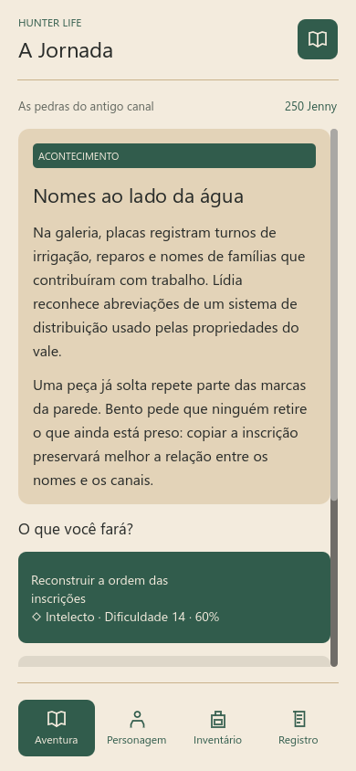
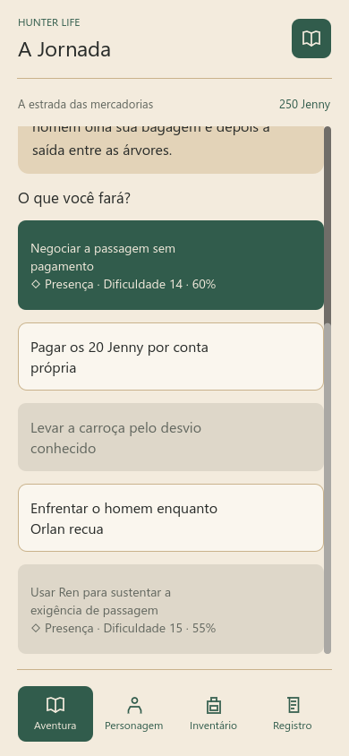

# Etapa 10B — Expansão narrativa

## Entrega

O catálogo passa de **58 para 78 acontecimentos**: **20 adições**, compostas por duas aventuras de seis cenas, cinco encontros independentes e três retornos ligados a decisões anteriores. Os 58 acontecimentos da revisão 10A foram preservados. Não foram acrescentados itens, adversários, Hatsus, abas ou sistemas de progressão.

O trabalho foi realizado somente no Hunter Life; os projetos One Piece Life não foram modificados. O Bloco 10C não foi iniciado.

## Escolta de um comerciante

**Orlan** é um comerciante cuidadoso com a carga e com os recibos. Prefere cumprir um contrato a transformar qualquer cobrança em luta. A aventura possui os seguintes acontecimentos:

| ID | Situação e decisões |
|---|---|
| `escort_offer` | Negociar ou aceitar o pagamento, ou recusar a escolta. |
| `escort_prepare` | Conferir mapas, preparar corda ou apenas contar os lacres antes da partida. |
| `escort_road` | Água sobre a estrada: guiar as rodas, usar preparação anterior ou pagar orientação local. |
| `escort_checkpoint` | Cobrança irregular: negociar, pagar, contornar, enfrentar ou demonstrar Ren. |
| `escort_account` | Conferir o contrato conforme perdas, gratificação e despesas, ou abrir mão do pagamento. |
| `escort_done` | Despedida e retorno às oportunidades da jornada. |

O contrato inicial vale 70 Jenny. Uma negociação bem-sucedida acrescenta gratificação de 20 se não houver perdas nem despesas pagas por Orlan. Carga molhada ou taxa paga por ele reduzem o acerto a 50 Jenny, sem somar descontos; isso é explicado no acordo e no fechamento. O jogador pode assumir pessoalmente a taxa de 20 Jenny para preservar o pagamento.

Não há combate obrigatório. Quem escolhe lutar enfrenta o assaltante já existente: vitória ou desistência do adversário leva ao acerto; fuga ou rendição leva à despedida, sem pagamento pela entrega. Incapacidade mantém a política anterior de encerramento da jornada. A força dos adversários não foi modificada.

`escort_completed` registra a entrega remunerada; `escort_unpaid` registra abrir mão do acerto, e `escort_loss` identifica pagamentos reduzidos. Preparação e gastos usam flags próprias. Encerrar sem entregar não inventa um serviço bem-sucedido no histórico.

## Expedição às ruínas

**Lídia**, pesquisadora, quer um registro verificável do antigo canal de abastecimento. **Bento**, pedreiro, avalia os apoios e prefere a retirada a arriscar a equipe por uma peça. O interesse histórico é o uso da água pelas propriedades da região.

| ID | Situação e decisões |
|---|---|
| `ruins_offer` | Aceitar ou recusar a vistoria; a licença pode ser apresentada como identificação. |
| `ruins_team` | Conhecer as funções e preparar planta, lanterna ou corda. |
| `ruins_entry` | Degrau quebrado: travessia, passagem baixa, preparo anterior ou Ten. |
| `ruins_archive` | Copiar inscrições, interpretar a sequência, iluminar marcas ou abrir uma veneziana com Precisão. |
| `ruins_choice` | Catalogar material, entregar relato parcial, ocultar e vender um fragmento ou priorizar a retirada. |
| `ruins_done` | Encerrar a vistoria e retomar a jornada. |

O relato utilizável rende 60 Jenny; a cópia completa com peça catalogada, 80. Ocultar o fragmento rende 100, mas registra `dishonest` e `ruins_stolen`, abrindo a consequência posterior. Priorizar a retirada sem material suficiente não paga pelo relatório. `ruins_shared` permite o retorno com Lídia; `ruins_completed` marca a entrega do trabalho.

Nen, Hatsu, ferramentas e licença oferecem alternativas, sem serem requisitos universais. Existe passagem baixa sem teste e sem item. Não há profecia, organização secreta ou descoberta sobrenatural.

## Encontros e consequências

| ID | Tipo | Conteúdo |
|---|---|---|
| `hearing` | Independente | Mediar uma discussão de entrega ou conferir documentos, sem pagamento prometido. |
| `reservoir` | Independente | Ajudar na comporta de um reservatório, usar Potência de Reforço ou chamar assistência. |
| `night_watch` | Independente | Conversa e orientação na varanda de um abrigo, usando observação ou mapa. |
| `kitchen` | Independente | Serviço de cozinha, refeição paga para recuperação ou espera sem recompensa. |
| `storm_mark` | Independente | Recolocar uma indicação de estrada com risco físico, corda ou sinalização simples. |
| `escort_return` | Consequência | Orlan oferece uma conferência de lacres após uma entrega remunerada. |
| `ruins_return` | Consequência | Lídia apresenta o registro a uma moradora depois de compartilhar os achados. |
| `false_account` | Consequência | Uma informação desonesta anterior é questionada: reparar parte da perda, admitir ou explicar. |

Os retornos têm condições explícitas de flags, não existem para personagens sem aquele passado. A cobrança por desonestidade também reconhece a flag dos acontecimentos antigos. Uma reparação não apaga retroativamente o ocorrido. Todos os 20 acontecimentos são únicos por jornada.

## Sistemas reutilizados e alterações de integração

- Quatro atributos, a mesma rolagem d20 e as probabilidades atuais.
- XP e níveis com a curva existente, Saúde, Jenny e resumo real das alterações.
- Corda, mapa e lanterna, sem consumi-los automaticamente. Nenhum item novo.
- Ten, Ren e os Hatsus já implementados: Reforço/Potência e Emissão/Precisão nas escolhas novas; demais técnicas e especializações continuam nas batalhas existentes.
- Flags booleanas para preparação, ajuda, entrega, achados e desonestidade.
- Continuação obrigatória e conclusão pelo motor atual. As duas aventuras funcionam em qualquer ordem.

Foi acrescentado somente um encaminhamento opcional: `battle_rewards.<resultado>.next` escolhe a continuação narrativa após o resultado da batalha. O catálogo valida que o destino existe; o encerramento o aplica uma vez, dentro da proteção de recompensa já existente. Isso permite separar entrega após vitória de retirada após fuga sem consultar flags globais de batalhas anteriores. A incapacidade continua limpando a continuação pendente.

Os IDs `escort` e `ruins` foram incluídos nas listas de aventuras aceitas pelo carregador e na tradução do Registro. As regras e fórmulas de combate não mudaram.

## Sorteio e equilíbrio

As duas novas oportunidades têm peso **2** cada. Os cinco encontros independentes e os três retornos têm peso **1**. Cenas internas têm peso zero e não entram no sorteio externo. Os pesos dos 58 acontecimentos anteriores foram preservados.

Na amostra de 500 seleções com sementes distintas e sem flags de consequências: escolta apareceu 15 vezes, ruínas 18, Exame Hunter 24 e entrega original 14. Todas as 26 oportunidades inicialmente elegíveis apareceram na amostra. Os retornos só entram na seleção após os fatos correspondentes.

Cada aventura nova pode conceder até **52 XP**, conforme o caminho. Em conjunto, não alcançam sozinhas os 120 XP acumulados necessários ao nível 3 partindo do nível 1. Muitos caminhos rendem menos. Recompensas maiores estão em conclusões ou desafios; esperar, conversar e recusar não rendem recursos por padrão. Nenhuma aventura é repetível para acumular ganhos.

Na regressão de 100 jornadas, os níveis finais foram: nível 1, 10 personagens; nível 2, 35; nível 3, 43; nível 4, 12. A maior frequência de níveis 3–4 acompanha a expansão do catálogo, sem alteração da curva.

## Salvamentos

O formato continua **v9**. Novas aventuras usam `adventure`, `completed`, `flags`, visitas, próximas cenas, histórico e estado de batalha já persistidos. Não há campos novos nem migração adicional. A validação aceita os dois novos identificadores; as migrações v2–v8 permanecem.

Carregar não sorteia novamente decisões, não concede pagamentos e não modifica categoria de Nen ou especialização. Resultados históricos não são recalculados. Foram testados estados anteriores sem flags novas, etapas intermediárias das duas aventuras, conclusões, batalha ativa, batalha resolvida e igualdade do próximo turno/RNG após carregar. Os testes usam um arquivo temporário próprio e não substituem o slot manual.

## Arquivos

### Criados

- `STAGE_10B.md`: este relatório.
- `tests/test_expansion.gd` e `.uid`: percursos, condições, persistência, batalhas e simulações.
- `tests/test_expansion_visual.gd` e `.uid`: layout e capturas das aventuras novas.
- Quinze capturas `tests/captures/10b_*.png`.

### Modificados nesta etapa

- `data/events.json`: 20 acontecimentos acrescentados aos 58 revisados.
- `scripts/battle.gd`: continuação opcional definida por resultado no JSON.
- `scripts/catalog.gd`: validação dessa continuação.
- `scripts/storage.gd`: aceitação dos dois IDs de aventura, sem mudar a versão do save.
- `scripts/ui/player_text.gd`: nomes legíveis das aventuras no Registro.
- `tests/test_foundation.gd`, `tests/test_narrative.gd`: contagens esperadas de catálogo e seleção.
- `tests/test_player_text.gd`: registros das novas aventuras incluídos na verificação.
- `tests/test_narrative_revision.gd`: protege a assinatura dos 58 originais separadamente das adições e verifica o catálogo completo.
- `README.md`: apresentação atual, novas aventuras, persistência, testes e link para este relatório.
- Capturas existentes atualizadas pela regressão visual. Logs: `tests/stage10b_*.log`.

Os relatórios anteriores permanecem separados e foram preservados. Alterações da 10A que já estavam no diretório de trabalho não foram descartadas.

## Validação executada

**22 suítes, 24.138 verificações, zero falhas na execução final.**

| Suíte | Verificações |
|---|---:|
| Fundação | 41 |
| Motor narrativo | 1.280 |
| Continuidade da interface | 26 |
| Jornadas | 237 |
| Progressão | 430 |
| Interface de progressão | 4 |
| Nen | 1.239 |
| Hatsus | 218 |
| Batalhas | 7.793 |
| Textos do jogador | 98 |
| Inventário | 528 |
| Exame Hunter | 2.603 |
| Integridade editorial | 371 |
| Expansão 10B | 6.601 |
| Interface geral | 348 |
| Interface Nen | 34 |
| Interface Hatsus | 180 |
| Interface batalhas | 68 |
| Interface inventário | 35 |
| Interface exame | 38 |
| Interface do catálogo completo | 1.740 |
| Interface da expansão | 226 |

Importação pelo editor e execução normal também realizadas no Godot 4.7.2. Logs finais sem erros ou avisos do motor. A assinatura mecânica dos 58 acontecimentos anteriores permanece idêntica à registrada na 10A.

### Percursos e simulações

- Conclusão dirigida das duas aventuras em ambas as ordens, sem Nen, equipamentos ou combate, mantendo Saúde 10.
- **100 percursos da escolta**, aceitando o serviço e depois escolhendo alternativas aleatórias elegíveis: 46 entregas remuneradas, 53 encerramentos sem entrega remunerada e uma incapacidade. O grupo sem entrega inclui fuga, rendição e abertura de mão do pagamento; não é uma estimativa de taxa de fracasso para uma estratégia cuidadosa.
- **100 percursos das ruínas:** 66 relatórios entregues e 34 retiradas sem entrega. As retiradas são escolhas possíveis, não bloqueios técnicos.
- Salvamento e igualdade integral de estado em cada passo dessas simulações.
- **100 jornadas completas adicionais:** chegaram a final narrativo ou incapacidade, sem bloqueios. A regressão de jornadas também passou, com máximo de 52 escolhas.
- As jornadas aleatórias visitaram 64 dos 78 acontecimentos. A amostra não demonstra acesso a todos os conteúdos condicionais; testes dirigidos verificaram os requisitos dos três retornos e das 20 adições, além das rotas das duas aventuras.
- Verificação específica de cada resultado do combate da escolta, idempotência de encerramento, carregamento no meio da luta e preservação da próxima resolução do RNG.
- Testes de dinheiro insuficiente, preparação, ferramentas, Ten, Ren, duas especializações de Hatsu, consequência de ocultação e ausência de recompensas por repetir uma escolha resolvida.
- A suíte do Exame Hunter manteve 16 combinações e 249 aprovações/51 reprovações na política dirigida anterior. O exame continua opcional.

### Interface e capturas

Todos os 78 acontecimentos foram renderizados em 320×480 e 390×844 com verificação de rolagem até a última escolha, ausência de transbordamento horizontal e navegação inferior separada do conteúdo. As suítes anteriores cobriram também 480×860, 768×1024 e 1100×720.

A suíte nova verificou sete cenas representativas da expansão em 320×480, 390×844 e 480×860 e produziu quinze capturas, incluindo o confronto da escolta. Foram inspecionadas visualmente a galeria das ruínas e as escolhas da barreira. A rolagem continua necessária para textos e opções longos; não houve redesenho da interface.

## Limitações

- As novas aventuras usam seis cenas cada, com variações por escolhas e flags; não são campanhas extensas.
- A escolta usa o assaltante existente e o confronto não simula a movimentação da carroça.
- O acerto de Orlan usa faixas fixas de pagamento, não uma economia de perdas por volume.
- O fragmento das ruínas é tratado como decisão de venda imediata, sem criar outro item de inventário.
- Retornos reconhecem decisões por flags, sem relações numéricas ou NPCs autônomos.
- A amostra de jornadas não substitui avaliação humana prolongada do ritmo e da escrita.
- Não há falhas críticas conhecidas nos fluxos testados. Não foram iniciados novos Hatsus ou o Bloco 10C.
