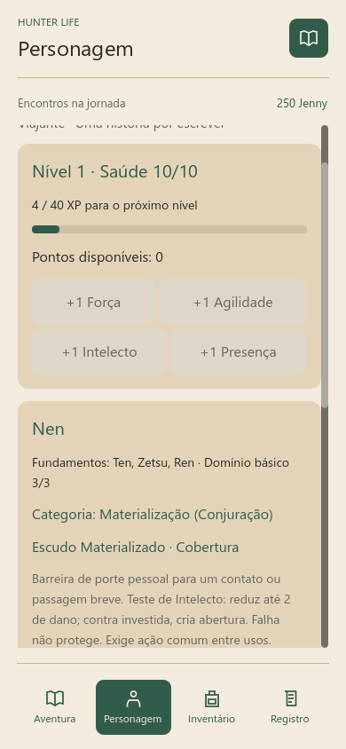
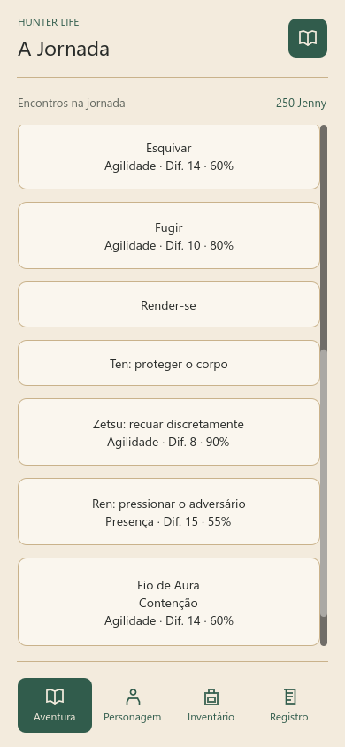

# Etapa 10C — Fio de Aura e Escudo Materializado

## Resultado

Implementados dois Hatsus com quatro especializações permanentes, reutilizando aprendizado, condições narrativas, testes d20, combate e salvamento existentes. O catálogo contém **80 acontecimentos**: os 78 anteriores e duas oportunidades de aprendizado com Mira. Foram acrescentadas seis escolhas contextuais a cenas existentes, preservando os índices, condições e resultados das escolhas anteriores.

Não foram iniciados os blocos 10D ou 10E. Os projetos One Piece Life não foram modificados.

## Aprendizado e categoria

| ID do Hatsu | Nome | Categoria persistida | Especializações |
|---|---|---|---|
| `transmutation` | Fio de Aura | Transmutação | `restraint` — Contenção; `mobility` — Mobilidade |
| `conjuration` | Escudo Materializado | Materialização | `resistance` — Resistência; `coverage` — Cobertura |

**Conjuração corresponde à Materialização já usada pelo jogo.** Esse valor interno permanece inalterado; Personagem apresenta “Materialização (Conjuração)” depois da revelação. Não foi acrescentada categoria, alterado o sorteio ou renomeada a afinidade nos saves.

As oportunidades `develop_transmutation` e `develop_conjuration` têm peso 2, são únicas e exigem os mesmos requisitos dos Hatsus anteriores: três fundamentos, adivinhação pela água concluída, categoria compatível e nenhum Hatsu desenvolvido. Não exigem nível, exame ou licença.

Mira apresenta características e limitações antes da escolha. O exercício usa dificuldade 13 e o atributo apropriado; sucesso concede 12 XP. No fracasso, a orientação reduz a exigência do exercício e permite aprender a forma inicial por 4 XP, sem repetição obrigatória. Recusar não desenvolve a habilidade. Depois de aprender, a especialização não pode ser trocada por outra opção de aprendizagem.

## Combate e parâmetros

O motor continua resolvendo uma ação do jogador e a resposta do adversário por turno. As novas ações usam o mesmo d20 e as probabilidades exibidas são calculadas por `Progress.chance`, a partir do teste real.

| Especialização | Teste | Sucesso | Fracasso |
|---|---|---|---|
| Fio — Contenção | Agilidade, dificuldade base do adversário, com modificadores ofensivos existentes | 1 de dano, redução de até 1 do ataque atual e abertura para a próxima ação | Sem dano, proteção ou abertura |
| Fio — Mobilidade | Agilidade, dificuldade base | Sem dano; redução de até 2 do ataque atual e abertura para a próxima ação | Sem proteção ou abertura |
| Escudo — Resistência | Intelecto, dificuldade base − 1 | Redução de até 4 do ataque atual, sem abertura | Redução de até 1 |
| Escudo — Cobertura | Intelecto, dificuldade base | Redução de até 2; se a intenção for investida, cria abertura para a próxima ação | Sem proteção ou abertura |

O fio limita um movimento e pode ceder; não elimina a resposta inimiga. Mobilidade depende de um apoio próximo, sem simulação de corda ou teletransporte. O escudo é uma peça física de porte pessoal, posicionada para um único movimento, que se desfaz ao fim da resposta atual. Cobertura não protege uma área ilimitada nem introduz aliados autônomos em combate.

Todas as especializações usam o intervalo compartilhado já existente: após uma ação especial, é necessária uma ação comum antes de outra técnica de aura. Não é possível usar Zetsu simultaneamente com esses Hatsus. A abertura usa o estado temporário anterior do combate e pode ser consumida ou perdida na ação seguinte; não há efeito de contenção acumulado ou imobilização persistente.

Os valores distinguem utilidade de dano: Contenção desgasta pouco enquanto cria oportunidade; Mobilidade prioriza deslocamento; Resistência bloqueia mais sem abrir contra-ataque; Cobertura pode aproveitar a investida. O aumento de pressão em turnos longos continua ativo, impedindo proteção indefinida. Os efeitos de Reforço, Emissão, equipamentos, Ten, Zetsu e Ren mantêm as regras anteriores.

## Integração narrativa

| Acontecimento existente | Alternativa adicionada |
|---|---|
| `signal_roof` | Mobilidade para puxar a corda da bandeira por um ponto próximo. |
| `exam_capture` | Contenção para retardar brevemente o suporte móvel e recolher a fita. Fracasso mantém a advertência por atraso. |
| `ruins_entry` | Mobilidade para alcançar um apoio próximo; falha leve leva à passagem baixa. |
| `blocked_passage` | Resistência para interpor o escudo durante a retirada dos trabalhadores. |
| `exam_team` | Cobertura para interceptar um contato enquanto o grupo passa; os candidatos ainda sustentam o portão. |
| `reservoir` | Cobertura para proteger o zelador ao soltar o calço. |

Cada alternativa exige exatamente seu Hatsu e sua especialização. As soluções anteriores continuam disponíveis e não exigem Nen. Os resultados descrevem falhas e limites físicos, sem transformar as novas opções em aprovação automática ou alterar as regras do Exame Hunter.

## Interface e persistência

A aba Personagem mostra categoria revelada, nome, especialização, efeito e limitações. Os nomes e as especializações de combate ficam em linhas separadas, com altura de botão ajustada ao texto e à probabilidade. A interface mantém quatro abas, paleta e rolagem.

O save permanece **v9**, sem novos campos ou migração adicional. Os novos valores cabem em `hatsu.id`, `hatsu.specialization` e `hatsu.learned`. As consequências usam os campos anteriores de abertura, cooldown, Saúde, RNG, flags e próximas cenas. Não existe estado adicional de escudo ou fio que precise ser reconstruído ao carregar.

A validação aceita somente as combinações de categoria, habilidade, fundamentos, revelação e especialização declaradas no catálogo de Hatsus. Estados incompatíveis são recusados, sem escrever sobre o arquivo. Categoria e especialização antigas não são recalculadas. As migrações anteriores permanecem disponíveis.

## Arquivos

### Produção e documentação

- `scripts/hatsu.gd`: duas habilidades, categorias, quatro especializações, descrições e validação reutilizada.
- `scripts/battle.gd`: testes e efeitos dos quatro usos, dentro da resolução existente.
- `scripts/main.gd`: apresentação dos Hatsus disponíveis e alias de Conjuração.
- `scripts/ui/battle_view.gd`: quebra de linha e altura dos botões.
- `data/events.json`: duas oportunidades com Mira e seis alternativas acrescentadas.
- `README.md`: estado atual, habilidades, saves e testes.
- `STAGE_10C.md`: este relatório.

### Testes e artefatos

- Criados `tests/test_hatsu_10c.gd`, `tests/test_hatsu_10c_visual.gd` e seus `.uid`.
- Atualizados `tests/test_foundation.gd`, `tests/test_exam.gd`, `tests/test_expansion.gd` e `tests/test_narrative_revision.gd` para as adições e seleção correta das alternativas.
- Doze capturas novas `tests/captures/10c_*.png`; capturas anteriores atualizadas pelas suítes visuais.
- Logs da execução final em `tests/stage10c_*.log`. Relatórios históricos preservados.

## Validação

**24 suítes, 29.630 verificações, zero falhas na execução final.** Importação pelo editor e execução normal realizadas no Godot 4.7.2, com logs finais sem erros ou avisos do motor.

| Suíte | Verificações |
|---|---:|
| Fundação | 41 |
| Motor narrativo | 1.280 |
| Continuidade da interface | 26 |
| Jornadas | 237 |
| Progressão | 430 |
| Interface de progressão | 4 |
| Nen | 1.239 |
| Hatsus anteriores | 218 |
| Batalhas | 7.793 |
| Textos do jogador | 98 |
| Inventário | 528 |
| Exame Hunter | 2.603 |
| Integridade editorial | 395 |
| Expansão 10B | 6.615 |
| Novos Hatsus | 4.794 |
| Interface geral | 348 |
| Interface Nen | 34 |
| Interface Hatsus anteriores | 180 |
| Interface batalhas | 68 |
| Interface inventário | 35 |
| Interface exame | 38 |
| Interface do catálogo completo | 1.784 |
| Interface expansão | 226 |
| Interface novos Hatsus | 616 |

As verificações específicas cobrem os dois aprendizados, sucesso e orientação após fracasso, persistência das quatro especializações, requisitos, recusa de combinações inválidas, impossibilidade de troca, probabilidades, cooldown compartilhado, diferenças mecânicas, sucesso e falha de combate e uso nas seis cenas. Saves durante os confrontos foram carregados e a próxima ação foi comparada, incluindo RNG e danos.

### Simulações

Foram executados 60 primeiros usos por especialização para verificar sucesso e fracasso, mais **800 confrontos** com atributos iniciais 5 e Saúde 10 contra o lutador: 100 por especialização em duas políticas. Não foram usadas melhorias de atributos, equipamentos ou recompensas para favorecer as amostras.

| Especialização | Vitórias/100, especial sempre disponível | Média de turnos | Vitórias/100, especial só diante de ataque/investida | Média de turnos |
|---|---:|---:|---:|---:|
| Contenção | 71 | 5,53 | 64 | 5,20 |
| Mobilidade | 67 | 6,42 | 59 | 5,85 |
| Resistência | 70 | 7,39 | 61 | 6,54 |
| Cobertura | 58 | 6,63 | 56 | 5,99 |

As políticas alternam ataques comuns quando não usam o especial; as diferenças mostram que nenhuma garante vitória. Elas não representam estratégias ótimas. Na primeira política, o maior confronto durou 12 turnos; usos defensivos sem dano podem prolongar a disputa. Alternar apenas proteção e defesa também terminou nos testes, sem ciclo infinito.

A regressão manteve os resultados do assaltante e do lutador sem as novas habilidades. O Exame Hunter preservou 16 combinações e 249 aprovações/51 reprovações na política dirigida anterior. As simulações de 100 percursos de cada aventura 10B mantiveram os mesmos grupos de conclusão e retirada. Jornadas completas com o catálogo ampliado terminaram sem bloqueios.

### Interface

Os quatro aprendizados/especializações foram verificados em **320×480, 390×844, 480×860, 768×1024 e 1100×720**, incluindo Personagem, botão de combate, probabilidade e resultado. O catálogo completo de 80 acontecimentos foi renderizado nas duas resoluções compactas. Rolagem e navegação inferior continuaram acessíveis; capturas de Personagem e ações de combate foram inspecionadas visualmente.

### Falhas de teste encontradas e corrigidas

- A fundação supunha que a segunda opção do evento inicial aleatório estaria disponível. O teste agora fixa uma cena conhecida para verificar os sinais.
- O teste do exame selecionava a última opção com qualquer Hatsu; passou a selecionar a combinação específica de ID e especialização que pretende testar.
- O teste visual novo referenciava um nome de controle inexistente; foi ajustado para a visualização de aventura realmente usada pelo projeto.

Não foi preciso alterar o balanceamento anterior para corrigir essas falhas. As execuções finais passaram.

## Capturas

## Limitações

- Não há física de filamentos, construção livre, aliados simulados ou consumo detalhado de aura.
- As proteções se aplicam aos ataques físicos do catálogo atual; não foi criado um sistema de tipos de dano.
- As ações de suporte podem prolongar a luta quando usadas sem uma oportunidade adequada. As simulações são amostras de políticas fixas, não prova de equilíbrio em toda situação possível.
- As oportunidades de desenvolvimento são únicas, como as anteriores; recusar não concede um novo treinamento automático.
- Manipulação e Especialização continuam sem Hatsus próprios. Nenhum conteúdo dos blocos 10D ou 10E foi implementado.
- Não há falhas críticas conhecidas nos fluxos testados.
