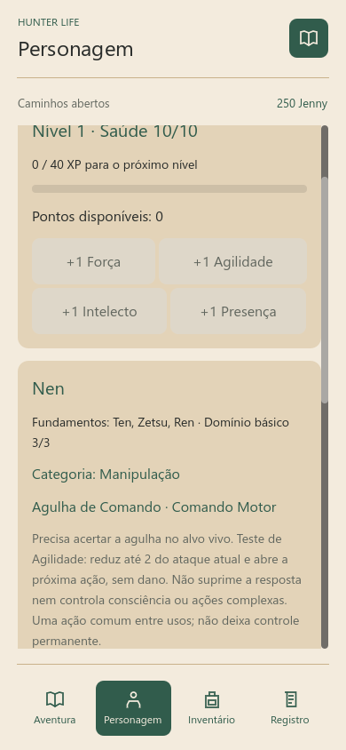
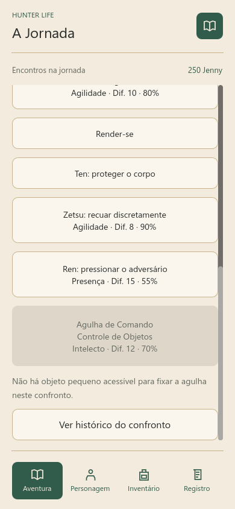

# Etapa 10D — Agulha de Comando

## Entrega

Implementado o primeiro Hatsu de **Manipulação**, com duas especializações permanentes: **Controle de Objetos** e **Comando Motor**. Aprendizado, combate, narrativa, interface e salvamento reutilizam as estruturas existentes.

O catálogo contém **81 acontecimentos**: os 80 anteriores e uma oportunidade de aprendizado com Mira. Foram acrescentadas quatro alternativas a acontecimentos existentes, sem modificar suas escolhas anteriores. Não foram implementados Especialização, três slots, áudio ou reorganização dos comandos de combate. As etapas 10E e 10F não foram iniciadas.

## Aprendizado

`develop_manipulation` é uma oportunidade única, de peso 2, elegível depois dos três fundamentos e da adivinhação pela água, com categoria Manipulação e nenhum Hatsu já desenvolvido. Não exige licença, exame ou nível mínimo.

Mira apresenta os alvos, a necessidade de atingir ou fixar a agulha, as diferenças entre as especializações e o caráter permanente da escolha. Controle de Objetos usa Intelecto; Comando Motor, Agilidade. Ambos usam dificuldade 13. Sucesso concede 12 XP; fracasso permite aprender a forma inicial com orientação por 4 XP, como os aprendizados anteriores. Recusar não concede habilidade nem recompensa.

As agulhas são instrumentos da habilidade, recolhidos depois do comando. Não há item novo, estoque de munição, fabricação ou comandos acumulados.

## Combate e balanceamento

| Regra | Controle de Objetos | Comando Motor |
|---|---|---|
| ID de especialização | `objects` | `motor` |
| Atributo | Intelecto | Agilidade |
| Dificuldade | Base do adversário − 2 | Base do adversário + 1 |
| Sucesso | Reduz até 1 do ataque atual e cria abertura | Reduz até 2 do ataque atual e cria abertura |
| Fracasso | Nenhuma proteção ou abertura | Nenhuma proteção ou abertura |
| Dano causado pelo comando | Zero | Zero |
| Alvo | Objeto pequeno, próximo e acessível | Movimento simples do adversário humano atingido |

Os modificadores ofensivos existentes de guarda, abertura e comportamento continuam aplicáveis. A chance exibida é calculada pelo mesmo método usado na resolução do d20. Não há sorteio percentual paralelo.

O comando termina na resposta atual e a abertura vale para a próxima ação, usando o estado temporário existente. A resposta adversária continua sendo processada, mesmo quando sua eficácia é reduzida. Não há imobilização permanente, domínio da consciência, alteração de personalidade ou sequência de ordens.

O intervalo compartilhado exige uma ação comum entre usos especiais e também bloqueia alternar imediatamente com Ten, Zetsu ou Ren. A pressão de confrontos longos continua em vigor; alternar apenas comando e defesa não gera proteção infinita.

### Alvos de objetos

O assaltante tem uma **fivela solta do cinturão**, acessível quando se aproxima. A apresentação informa esse alvo para o usuário da especialização. Um puxão simples interfere no equilíbrio do equipamento, sem transformar o objeto em arma ou controlar seu corpo inteiro.

O lutador experiente e Daro não têm objeto apropriado declarado. A ação fica desabilitada, com explicação visível em português e tooltip. A lógica também a recusa: não consome turno, RNG, Saúde ou cooldown. O alvo é derivado do adversário persistido, sem criar inventário de NPCs ou novo estado de equipamentos.

Controle de Objetos tem teste mais acessível, mas disponibilidade limitada e proteção menor. Comando Motor exige acertar o alvo vivo com um teste mais difícil e oferece redução maior. Nenhum deles causa dano automático ou substitui os ataques necessários para vencer.

## Integração narrativa

| Acontecimento | Especialização | Uso e consequência |
|---|---|---|
| `signal_roof` | Controle de Objetos | Subir pela escada para fixar a agulha na trava próxima e liberar a bandeira; falhar deixa o reparo ao artesão. |
| `reservoir` | Controle de Objetos | Girar um fecho acessível junto à manivela; falhar pode causar ferimento leve e interrompe a tentativa. |
| `exam_capture` | Controle de Objetos | Esperar a passagem do suporte por um ponto alcançável e liberar a trava; falhar rende a advertência por atraso. |
| `escort_checkpoint` | Comando Motor | Interromper o braço que sustenta a corda para Orlan passar; falhar inicia o confronto com o assaltante. |

Os testes e as consequências são definidos no JSON. Cada alternativa exige exatamente a especialização correta. As soluções anteriores e os caminhos sem Nen permanecem disponíveis. As regras de resultado do Exame Hunter e da escolta não foram alteradas.

## Interface e salvamento

A aba Personagem utiliza o catálogo atual de Hatsus para mostrar Manipulação, Agulha de Comando, especialização, efeito e limitações. O botão utiliza a apresentação de combate já existente, com nome, especialização e probabilidade. A falta de objeto é explicada na própria tela, inclusive em resoluções compactas. Não houve divisão em categorias ou novas abas.

O save continua **v9**. Os campos `hatsu.id`, `hatsu.specialization` e `hatsu.learned` já são suficientes; os novos valores são `manipulation`, `objects` e `motor`. A validação existente foi estendida pelo catálogo de combinações permitidas. Categoria de Nen, especialização antiga, RNG, histórico e recompensas resolvidas não são recalculados.

Foi corrigida uma limitação do carregador: o confronto podia ser validado somente quando declarado diretamente na escolha, ignorando seu ramo de fracasso. Agora o inimigo deve corresponder a um dos dois ramos escritos no catálogo. Isso permite salvar a nova tentativa de interromper a barreira quando ela falha e inicia uma batalha. Confrontos não previstos pela escolha continuam rejeitados; carregar não reaplica rolagens, dano ou recompensas.

## Arquivos

### Criados

- `STAGE_10D.md`: este relatório.
- `tests/test_manipulation.gd` e `.uid`: preservação do catálogo anterior, requisitos, permanência, alvos, resultados, persistência e simulações.
- `tests/test_manipulation_visual.gd` e `.uid`: legibilidade, disponibilidade contextual e capturas.
- Sete capturas `tests/captures/10d_*.png`.

### Modificados

- `scripts/hatsu.gd`: categoria, nome, especializações e descrições.
- `scripts/battle.gd`: alvo acessível, requisito de uso, testes e efeitos.
- `scripts/ui/battle_view.gd`: apresentação do alvo e explicação de indisponibilidade.
- `scripts/storage.gd`: validação de batalha iniciada pelo ramo de fracasso.
- `data/events.json`: um aprendizado e quatro escolhas acrescentadas.
- `tests/test_foundation.gd`, `tests/test_expansion.gd`, `tests/test_narrative_revision.gd`: contagem do catálogo.
- `tests/test_hatsu_10c.gd`: seleção das alternativas por ID/especialização, preservando o propósito da regressão após novas opções no mesmo evento.
- `README.md`: estado atual, habilidade, salvamento, testes e link para este relatório.
- Capturas anteriores atualizadas pelas suítes visuais. Logs em `tests/stage10d_*.log`.

Os relatórios históricos e os projetos One Piece Life foram preservados. Não houve alteração de inventário, atributos, curva de XP, categorias sorteadas ou aprendizado básico de Nen.

## Validação

**26 suítes, 34.372 verificações, zero falhas na execução final.** O projeto foi importado e executado no Godot 4.7.2; os logs finais não apresentam erros ou avisos do motor.

| Suíte | Verificações |
|---|---:|
| Fundação | 41 |
| Motor narrativo | 1.280 |
| Continuidade da interface | 26 |
| Jornadas | 237 |
| Progressão | 430 |
| Interface de progressão | 4 |
| Nen | 1.239 |
| Hatsus anteriores | 218 |
| Batalhas | 7.793 |
| Textos do jogador | 98 |
| Inventário | 528 |
| Exame Hunter | 2.603 |
| Integridade editorial | 409 |
| Expansão 10B | 6.615 |
| Hatsus 10C | 4.794 |
| Manipulação | 4.354 |
| Interface geral | 348 |
| Interface Nen | 34 |
| Interface Hatsus anteriores | 180 |
| Interface batalhas | 68 |
| Interface inventário | 35 |
| Interface exame | 38 |
| Interface catálogo completo | 1.806 |
| Interface expansão | 226 |
| Interface Hatsus 10C | 616 |
| Interface Manipulação | 352 |

### Preservação e persistência

A nova suíte compara uma assinatura integral dos **80 acontecimentos da 10C**, removendo apenas as quatro opções recém-acrescentadas antes da comparação. O hash permanece:

```text
021ced9bea2ae52155c5593e7268c026f525f78bee57931ddfd41c2247a15118
```

Essa verificação inclui textos, escolhas, índices, condições, recompensas, ramificações e regras anteriores. Também passaram as regressões dos quatro Hatsus anteriores, inventário, equipamentos, migrações e salvamento v9.

Foram verificados aprendizado com sucesso e orientação após falha, permanência da escolha, seis categorias de Nen, ausência de revelação ou fundamentos, especialização inválida, save de categoria incompatível, bloqueio sem alvo, cooldown compartilhado e igualdade de estado/RNG após salvar e carregar no meio do confronto. Os arquivos de teste são temporários e não substituem o slot manual.

Cada alternativa narrativa foi resolvida em 25 sementes, cobrindo sucesso e fracasso e persistência. O caso da escolta verificou carregamento da batalha iniciada pela falha e continuidade após rendição, sem pagamento indevido por entrega.

### Simulações de combate

Em 100 primeiros usos por especialização, contra a investida do assaltante e com atributos 5: Controle de Objetos teve 81 sucessos/19 falhas; Comando Motor, 65/35. As chances teóricas são 80% e 65%; as amostras usam a rolagem d20 real.

Foram simulados **400 confrontos**, usando o especial quando disponível e atacando quando não estivesse. Os confrontos completos usam as intenções iniciais normais de cada adversário.

| Especialização | Adversário | Vitórias ou desistências do adversário/100 | Média de turnos | Máximo |
|---|---|---:|---:|---:|
| Controle de Objetos | Assaltante | 85 | 3,95 | 7 |
| Controle de Objetos | Lutador | 68 | 4,55 | 7 |
| Comando Motor | Assaltante | 87 | 4,05 | 8 |
| Comando Motor | Lutador | 68 | 6,17 | 9 |

Contra o lutador, Controle de Objetos está indisponível e a política usa ataques comuns. Os resultados não demonstram estratégia ótima nem garantem vitória com a habilidade. Alternar comando e defesa sem atacar terminou por incapacidade nos cenários dirigidos, sem ciclo infinito.

As simulações anteriores de combate e dos Hatsus 10C mantiveram seus resultados. O Exame Hunter preservou as 16 combinações e 249 aprovações/51 reprovações da política dirigida anterior. Os 100 percursos de cada aventura 10B preservaram seus grupos de conclusão/retirada, e as jornadas completas terminaram sem bloqueios.

### Interface

Verificadas **320×480, 390×844, 480×860, 768×1024 e 1100×720**. A suíte nova cobre Personagem, as duas especializações contra assaltante e lutador, ação sem alvo, probabilidade, rolagem, navegação e aprendizado por sinal de interface. O catálogo de 81 acontecimentos também foi renderizado nas duas resoluções compactas. Capturas de Personagem e do bloqueio sem alvo foram inspecionadas visualmente.

## Capturas





## Limitações

- Controle de Objetos possui alvo explicitamente declarado apenas no assaltante, além dos mecanismos das escolhas narrativas. Não existe simulação livre de objetos ou equipamentos inimigos.
- Comando Motor atua nos adversários humanos atuais; não foi acrescentada uma classificação geral de criaturas ou anatomia.
- Efeitos são breves e usam abertura/proteção existentes. Não há estado de controle mantido, munição, fabricação ou inventário de agulhas.
- A oportunidade de aprendizado é única, como as anteriores. Recusar não gera treino automático posterior.
- Especialização continua sem Hatsu. Não foram implementados três slots, áudio ou a interface prevista para a 10F.
- Não há falhas críticas conhecidas nos fluxos testados; as amostras automatizadas não substituem avaliação humana prolongada de equilíbrio.
