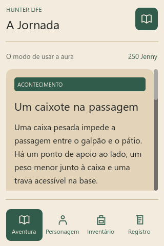
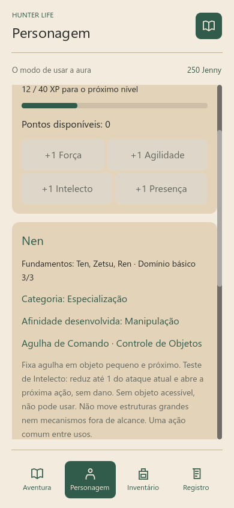

# Etapa 10E — Afinidade do Especialista

## Resultado

Personagens da categoria **Especialização** podem aceitar uma avaliação opcional com Mira, atravessar cinco situações e desenvolver permanentemente um dos cinco Hatsus existentes. A categoria de Nen permanece Especialização. Somente a especialização interna da habilidade revelada é escolhida diretamente pelo jogador.

O catálogo passa de **81 para 92 acontecimentos**: um convite, cinco cenas de avaliação e cinco variantes de revelação. Uma partida vê somente a revelação correspondente ao resultado. Os 81 acontecimentos anteriores, suas escolhas e as aventuras foram preservados. Não há Hatsu novo, categoria nova, atributo, recurso, três slots ou reorganização do combate. A Etapa 10F não foi iniciada.

## Estrutura narrativa

| Acontecimento | Situação |
|---|---|
| `affinity_offer` | Mira apresenta o propósito, a possibilidade de recusar antes de começar e o compromisso de assumir o resultado. |
| `affinity_trial_1` | Uma caixa bloqueia a passagem: esforço, projeção, tensão, forma ou movimento de uma trava. |
| `affinity_trial_2` | Uma fita fora do alcance exige lidar com distância e apoios. |
| `affinity_trial_3` | Um acolchoado num trilho exige uma reação preparada, sob supervisão. |
| `affinity_trial_4` | Uma calha reposicionada exige adaptar a maneira de resolver um problema. |
| `affinity_trial_5` | O personagem decide o que demonstrar sem receber um problema pronto. |
| `affinity_reveal_<id>` | Mira interpreta o conjunto, revela a habilidade e orienta sua especialização interna. Existem cinco variantes. |

Cada uma das cinco cenas oferece **uma alternativa de cada afinidade**. As posições são rotacionadas entre as cenas, evitando associar a primeira opção sempre à mesma categoria. As opções são intenções narrativas, sem nomear o Hatsu que pontuam. A interface não mostra pontos ou porcentagens de categoria.

Todas as tentativas usam os atributos existentes e dificuldade 13. Sucesso e fracasso têm textos distintos; Mira orienta as dificuldades e mantém a avaliação segura. Não há dano, custo financeiro ou condição de eliminação no meio da sequência. As cinco cenas não concedem XP; desenvolver a especialização ao final concede 12 XP uma única vez.

## Determinação da afinidade

O algoritmo provisório fica isolado em `scripts/affinity.gd`.

1. Cada decisão contribui **3 pontos** para sua abordagem.
2. Um teste bem-sucedido acrescenta **1 ponto** à mesma abordagem. Fracassar não retira os pontos da intenção.
3. Ao completar as cinco cenas, são consideradas as afinidades com maior total.
4. Persistindo empate, prefere-se a mais recorrente nas **duas decisões finais**.
5. Persistindo empate, compara-se o atributo pertinente, fotografado no início da avaliação.
6. Persistindo empate, vale a decisão mais recente entre as ainda empatadas. Não há novo sorteio nem preferência fixa por ordem de categorias.

| Afinidade | Atributo para desempate | Hatsu |
|---|---|---|
| Reforço | Força | Corpo Temperado |
| Emissão | Agilidade | Projétil de Aura |
| Transmutação | Agilidade | Fio de Aura |
| Materialização/Conjuração | Intelecto | Escudo Materializado |
| Manipulação | Presença | Agulha de Comando |

Essa escala torna a quantidade de intenções predominante: três escolhas fracassadas valem 9, superando duas bem-sucedidas, que valem 8. Uma afinidade escolhida uma vez não supera outra escolhida duas, mesmo com sorte favorável. O bônus das rolagens diferencia tendências escolhidas o mesmo número de vezes. A terceira etapa do desempate usa atributos congelados para que mudanças posteriores não alterem uma conclusão já estabelecida.

O resultado é calculado ao resolver a quinta decisão e armazenado. A validação do save verifica sua consistência, sem substituir o valor, rolar novamente ou reaplicar efeitos. A ficha só o exibe quando a cena de revelação de Mira é aberta, evitando antecipar essa conversa.

## Permanência e integração

Começar exige Ten, Zetsu e Ren concluídos, adivinhação pela água revelando Especialização, nenhum Hatsu e avaliação não iniciada. Não exige nível, exame ou licença. Antes de começar há recusa; depois, as cinco cenas e a revelação têm somente caminhos de continuação.

Durante a avaliação, o estado bloqueia saltar para outros acontecimentos, reabrir a cena atual ou voltar às anteriores. Depois de revelar, apenas as especializações da habilidade determinada são oferecidas. Após aprender, não é possível reabrir a avaliação ou desenvolver outro Hatsu naquela jornada.

O Especialista recebe o mesmo `hatsu.id` e a mesma especialização usados pelas categorias originais. **Não existe implementação paralela de combate.** Testes, dano, proteção, aberturas, intervalo de técnicas, equipamentos e alvos continuam nas funções anteriores. Um Especialista com Controle de Objetos, por exemplo, também fica sem essa ação contra adversários sem objeto acessível.

As condições narrativas existentes já consultavam ID e especialização do Hatsu, não exigiam a categoria original. Elas foram reutilizadas, dando acesso somente às alternativas da habilidade realmente aprendida. Nenhum caminho sem Nen foi removido.

## Persistência v9 e checkpoints

O save permanece **v9**, com o novo campo opcional `affinity`:

```json
{
  "phase": "unstarted",
  "decisions": [],
  "scores": {
    "reinforce": 0,
    "emission": 0,
    "transmutation": 0,
    "conjuration": 0,
    "manipulation": 0
  },
  "result": "",
  "attributes": {}
}
```

As fases são `unstarted`, `active`, `resolved` e `learned`. Cada decisão registra cena, índice, abordagem, rolagem, valor do atributo, dificuldade e sucesso. A etapa é determinada pela sequência de decisões e pelo acontecimento atual, evitando manter dois contadores concorrentes. `attributes` conserva os valores do início para desempate.

Saves anteriores sem esse campo recebem estado não iniciado. Nada é inventado retroativamente; categoria, histórico, XP, inventário e Hatsus anteriores permanecem. As migrações v2–v8 continuam disponíveis. A validação rejeita pontuação inconsistente, resultado incompatível, conclusão antecipada e Hatsu de Especialista sem a avaliação correspondente.

### Evitar retorno a uma decisão anterior

Salvar apenas no slot manual não impediria carregar um ponto anterior à avaliação. Por isso, cada decisão executada pela interface, incluindo aceitação inicial e especialização final, gera um **checkpoint separado**, usando a gravação atômica existente:

- Diretório: `user://affinity_checkpoints/`.
- Uma chave derivada da semente e do nome imutável identifica a jornada, sem consumir RNG narrativo.
- O checkpoint contém o estado completo após a decisão; o slot `hunter_life.json` não é sobrescrito automaticamente.
- Carregar o slot manual verifica o checkpoint da mesma jornada e o utiliza quando estiver mais adiantado.
- Um manual mais recente prevalece sobre um checkpoint antigo.
- **Retomar registro de Mira**, na criação, permite continuar mesmo sem slot manual, ou retomar a avaliação correspondente ao último registro.
- Jornadas diferentes mantêm arquivos separados. Checkpoints não são apagados automaticamente.

Retomar pode apresentar o resultado já resolvido da última cena e seu botão de continuar, em vez de abrir imediatamente a seguinte. Isso preserva exatamente a decisão e a rolagem sem repeti-las. Não há recompensa ao carregar.

## Arquivos

### Criados

- `scripts/affinity.gd` e `.uid`: fases, requisitos, pontuação, desempate e validação.
- `tests/test_affinity.gd` e `.uid`: percurso, resultados, persistência, checkpoints e paridade com categorias originais.
- `tests/test_affinity_visual.gd` e `.uid`: sequência pela interface, retomada, revelação e Personagem.
- `STAGE_10E.md`: este relatório.
- Onze capturas `tests/captures/10e_*.png`.

### Modificados

- `scripts/game_state.gd`: estado opcional, captura da rolagem existente, avanço obrigatório e serialização.
- `scripts/hatsu.gd`: autorização limitada para o resultado do Especialista e permanência após aprender.
- `scripts/catalog.gd`: elegibilidade da oportunidade de avaliação.
- `scripts/storage.gd`: migração opcional, normalização/validação e checkpoints separados.
- `scripts/main.gd`: checkpoint ao decidir, retomada e apresentação de categoria/afinidade.
- `scripts/ui/player_text.gd`: nome legível da avaliação no Registro.
- `data/events.json`: onze acontecimentos acrescentados, sem editar os anteriores.
- `tests/test_foundation.gd`, `tests/test_expansion.gd`, `tests/test_manipulation.gd`, `tests/test_narrative_revision.gd`: contagem do catálogo ampliado.
- `README.md`: estado atual, funcionamento e persistência.
- Capturas anteriores atualizadas pelas regressões. Logs: `tests/stage10e_*.log`.

Os relatórios históricos e os projetos One Piece Life foram preservados. O código de combate e o catálogo de itens não foram alterados.

## Testes e resultados

**28 suítes, 36.705 verificações, zero falhas na execução final.** Importação e execução normal realizadas no Godot 4.7.2, com logs finais sem erros ou avisos do motor.

| Suíte | Verificações |
|---|---:|
| Fundação | 41 |
| Motor narrativo | 1.280 |
| Continuidade de interface | 26 |
| Jornadas | 237 |
| Progressão | 430 |
| Interface de progressão | 4 |
| Nen | 1.239 |
| Hatsus anteriores | 218 |
| Batalhas | 7.793 |
| Textos do jogador | 108 |
| Inventário | 528 |
| Exame Hunter | 2.603 |
| Integridade editorial | 483 |
| Expansão 10B | 6.617 |
| Hatsus 10C | 4.794 |
| Manipulação | 4.354 |
| Afinidade | 1.364 |
| Interface geral | 348 |
| Interface Nen | 34 |
| Interface Hatsus anteriores | 180 |
| Interface batalhas | 68 |
| Interface inventário | 35 |
| Interface exame | 38 |
| Interface catálogo completo | 2.048 |
| Interface expansão | 226 |
| Interface Hatsus 10C | 616 |
| Interface Manipulação | 352 |
| Interface Afinidade | 641 |

### Avaliação e paridade

- As cinco afinidades foram alcançadas por decisões dirigidas.
- Todas as **11 especializações internas** dos cinco Hatsus foram aprendidas, salvas e carregadas por Especialistas.
- Os percursos dirigidos registraram 47 testes bem-sucedidos e oito fracassos, todos permitindo conclusão.
- Cada Especialista foi comparado a um personagem da categoria original com os mesmos atributos, equipamento e RNG: os testes de todas as ações e a resolução do Hatsu em combate foram iguais.
- As alternativas narrativas foram comparadas pelas mesmas condições, confirmando acesso à habilidade aprendida e bloqueio das outras.
- Foram verificados requisitos, permanência, desempate por história/atributo/recência, bloqueio de retorno à avaliação e rejeição de resultado adulterado ou conclusão prematura.

### Simulação de escolhas variadas

Em **200 avaliações completas**, com atributos iniciais iguais e decisões aleatórias entre cinco opções por cena:

| Resultado | Personagens |
|---|---:|
| Reforço | 42 |
| Emissão | 33 |
| Transmutação | 38 |
| Conjuração | 41 |
| Manipulação | 46 |

Todas foram alcançadas. A amostra ilustra variedade, não promete distribuição uniforme em qualquer estilo de jogo. A representação das cinco afinidades em cada cena foi verificada separadamente.

### Saves e regressões

Foram testados salvamentos após decisões e ao abrir as cenas seguintes, depois da revelação, após a especialização e durante combate. Os estados e RNG foram comparados integralmente. Checkpoints retomaram pontos antigos sem repetir decisões, não alteraram o arquivo manual, não substituíram outra jornada e respeitaram um manual mais recente. O fluxo visual também saiu para a criação no meio da avaliação e retomou pelo botão de Mira.

As suítes anteriores passaram. O exame manteve 16 combinações e 249 aprovações/51 reprovações na política dirigida anterior. Os grupos de conclusão das aventuras da 10B e os resultados dos Hatsus anteriores permaneceram. As jornadas completas com o catálogo ampliado terminaram sem bloqueios.

Durante a implementação, os testes detectaram que números JSON chegam como ponto flutuante e impediam a comparação de dicionários com os inteiros originais. A normalização foi acrescentada após a validação de limites e integralidade. A execução final dos round-trips passou sem perda de dados.

### Interface

Foram verificadas **320×480, 390×844, 480×860, 768×1024 e 1100×720**. A suíte nova executou a avaliação, a retomada e a aprendizagem pela interface para os cinco resultados, com onze capturas. Verificou que a ficha não antecipa a revelação antes da conversa com Mira. Os 92 acontecimentos também foram renderizados nas duas resoluções compactas. Capturas da primeira situação e da ficha do Especialista foram inspecionadas visualmente; a navegação permanece separada da área de rolagem.

## Capturas





## Limitações

- É uma versão provisória da avaliação, com situações e critérios escritos previamente. Não é criação livre de Hatsu nem uma sexta habilidade.
- Os checkpoints impedem retorno pelo carregamento normal enquanto os registros locais existem; não constituem proteção contra edição ou remoção externa de arquivos.
- O checkpoint conserva o estado após decisões da avaliação; outras ações continuam sujeitas ao salvamento manual normal. Se houver falha real de gravação, a interface avisa para salvar antes de sair.
- Checkpoints de jornadas anteriores permanecem no diretório; não há gerenciador ou limpeza automática nesta etapa.
- Textos de revelação e limitações exigem rolagem em telas pequenas, mantendo escolhas e navegação acessíveis.
- Não há falhas críticas conhecidas nos fluxos testados. A Etapa 10F não foi iniciada.
