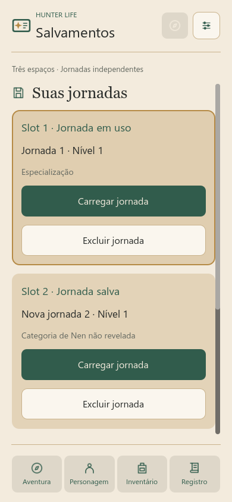
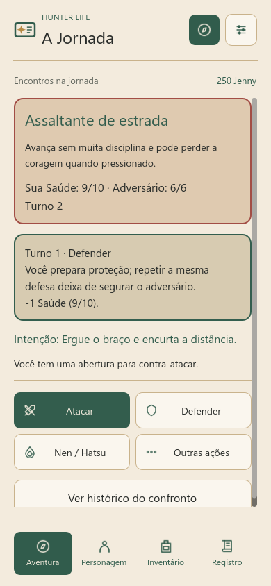

# Etapa 10F — Salvamentos e interface de combate

## Entrega

Implementados **três slots independentes** e um **menu de combate com quatro categorias**. O formato interno permanece v9. Os 92 acontecimentos, cinco Hatsus, itens, atributos, testes, recompensas e regras de combate não foram alterados. Não foram acrescentados áudio, ícones ou animações. As etapas 10G e 10H não foram iniciadas.

O salvamento antigo real desta instalação foi validado e migrado para o Slot 1 na abertura normal do jogo. A comparação integral do estado carregado confirmou a preservação da jornada; o hash do arquivo original permaneceu idêntico. Slots 2 e 3 continuaram vazios. Não havia checkpoints antigos nessa instalação; esses casos foram verificados com fixtures isoladas.

## Organização dos slots

| Arquivo | Função |
|---|---|
| `user://saves/slot_1/save.json` | Jornada manual do Slot 1, em v9 |
| `user://saves/slot_2/save.json` | Jornada manual do Slot 2, em v9 |
| `user://saves/slot_3/save.json` | Jornada manual do Slot 3, em v9 |
| `user://saves/slot_N/owner.json` | Identificação da jornada, geração e estado de criação/exclusão |
| `user://saves/slot_N/checkpoints/` | Checkpoints exclusivos daquele slot |
| `user://saves/legacy_migration.json` | Registro durável da migração antiga |

`scripts/save_slots.gd` gerencia esses arquivos e reutiliza o carregador, as migrações e a gravação atômica de `storage.gd`. Não existe um segundo serializador de personagem.

O menu apresenta os três espaços. Em um ocupado, o resumo vem de dados validados, incluindo checkpoint mais adiantado quando aplicável. Nome e nível aparecem; a categoria de Nen só é mostrada depois da revelação pela água. Arquivos inválidos não são tratados como slots vazios nem sobrescritos para criar um personagem.

Criar exige espaço vazio e grava um primeiro estado. Salvar pelo Registro usa o slot correspondente à sessão. **Gerenciar jornadas**, em Personagem, abre o menu; é possível voltar à sessão atual. Cancelar o formulário de criação mantém a sessão anterior em memória, sem substituí-la por outro personagem.

### Identificação e isolamento

A identificação da 10E, derivada de nome imutável e semente da jornada, foi mantida. Cada ocupação de um slot recebe também um token de geração, produzido sem consumir o RNG narrativo. A sessão carregada é vinculada a essa geração por metadados em memória, fora do JSON do personagem.

Salvar ou registrar checkpoint exige coincidência entre jornada, geração e slot ativo. Uma confirmação ou sessão antiga não pode alterar uma nova ocupação do mesmo espaço. O isolamento também foi testado com duas fixtures que possuem exatamente o mesmo nome e semente: as gerações continuam diferentes.

## Migração do arquivo anterior

O arquivo `user://hunter_life.json` continua preservado como backup. Na abertura do menu:

1. O arquivo é carregado e validado pelas migrações históricas existentes.
2. Um checkpoint antigo da mesma jornada, se mais adiantado, é considerado.
3. Se o Slot 1 estiver vazio, é gravado um registro de migração pendente, com identificação da fonte e geração de destino.
4. A jornada é gravada no Slot 1 e validada novamente; seus checkpoints são associados ao novo diretório.
5. O registro passa a concluído. A importação não se repete, inclusive após excluir o slot.

Se o Slot 1 estiver ocupado, não há substituição. Fonte inválida, identificação incompatível ou destino danificado produzem mensagem e preservam os arquivos. Se houver interrupção entre o registro pendente, a criação da identificação e a gravação do save, a próxima abertura consegue retomar a operação quando os registros forem consistentes.

O original não é apagado nem regravado. Um destino inválido não é silenciosamente substituído para reparar uma migração. O carregamento histórico v2–v8 continua sendo responsabilidade de `storage.gd`, que produz o estado atual v9.

## Checkpoints da Especialização

O carregamento normal de um slot consulta somente seu diretório de checkpoints, pela identificação da jornada. Não usa o ponteiro global da 10E para escolher uma avaliação de outro slot. Um manual antigo da mesma jornada retoma a decisão já registrada; um manual mais recente prevalece.

Durante a migração, registros antigos em `user://affinity_checkpoints/` são copiados para o slot correspondente. Registros válidos sem jornada associada podem ser recuperados explicitamente em um espaço vazio pelo menu, inclusive quando não existe arquivo manual antigo. Um registro já associado não é oferecido para criar outra cópia em outro slot.

Excluir uma jornada exige confirmação. A remoção:

- verifica novamente a geração apresentada no pedido;
- marca a exclusão em andamento para permitir uma nova tentativa se houver interrupção;
- remove os arquivos manuais e checkpoints do slot;
- remove o checkpoint antigo correspondente quando ele foi adotado pela jornada;
- preserva os outros slots e registros antigos de outras jornadas;
- mantém o registro de migração concluído para não ressuscitar o backup antigo.

Não há remoção recursiva de diretórios de jogo: a rotina atua sobre arquivos no diretório fixo do slot e recusa subpastas inesperadas. Pastas vazias podem permanecer. Uma nova ocupação recebe geração nova e não herda os checkpoints removidos.

## Menu de combate

| Categoria | IDs existentes |
|---|---|
| Atacar | `attack`, `quick` |
| Defender | `defend`, `dodge` |
| Nen / Hatsu | `ten`, `zetsu`, `ren`, `hatsu` |
| Outras ações | `flee`, `yield` |

O menu principal usa quatro botões em duas colunas. Cada submenu apresenta suas ações e **Voltar ao menu principal**. Somente a área de comandos muda; adversário, Saúde, intenção, último resultado e abertura permanecem na apresentação do confronto. O histórico continua acessível.

Abrir ou voltar apenas altera controles da interface. Não chama a resolução, não modifica turno, RNG, Saúde ou cooldown. Os botões de ação emitem os mesmos IDs e tokens para `Battle.act`. Uma ação válida reconstrói a visualização no menu principal; ações indisponíveis não avançam o estado.

Sem Nen, as técnicas aparecem desabilitadas e explicadas, inclusive em texto para toque. Quando existe Hatsu, o botão mostra somente sua habilidade e especialização reais. Especialistas usam o Hatsu definido pela avaliação. Probabilidades continuam vindo do mesmo teste e da mesma fórmula anteriores. Limitações de alvo, proteção, dano, aberturas e intervalo compartilhado não mudaram.

## Arquivos

### Criados

- `scripts/save_slots.gd` e `.uid`: slots, identificação, migração, associação e exclusão.
- `tests/test_slots.gd` e `.uid`: isolamento, persistência, migração e recuperação.
- `tests/test_slots_ui.gd` e `.uid`: criação, carregamento, confirmação, retomada e layout.
- `tests/test_combat_menu.gd` e `.uid`: navegação, efeitos, Hatsus, persistência e layout.
- `STAGE_10F.md`: este relatório.
- Doze capturas `tests/captures/10f_*.png`.

### Modificados

- `scripts/main.gd`: fluxo dos slots e vínculo da sessão, diálogo de exclusão, gravação e checkpoints no destino correto.
- `scripts/ui/battle_view.gd`: agrupamento dos comandos e retorno ao menu.
- `scripts/ui/creation_view.gd`: remoção da identificação antiga “Etapa 3” do rodapé.
- `tests/test_foundation.gd`, `tests/test_visual.gd`: criação e abertura do formulário no novo fluxo.
- `tests/test_battle_visual.gd`, `tests/test_hatsu_10c_visual.gd`, `tests/test_manipulation_visual.gd`: navegação até as categorias antes das ações.
- `tests/test_affinity_visual.gd`: retomada do checkpoint, sem depender do antigo botão global da 10E; o fluxo completo por slot é coberto pela suíte nova.
- `README.md`: uso atual, diretórios, migração e testes.
- Capturas anteriores atualizadas pelas regressões. Logs em `tests/stage10f_*.log`.

Os relatórios anteriores foram preservados. `game_state.gd`, `battle.gd`, `hatsu.gd`, `nen.gd`, `storage.gd`, `events.json` e `items.json` não foram alterados nesta etapa. Os projetos One Piece Life permaneceram intactos.

## Testes executados

**31 suítes, 37.016 verificações, zero falhas na execução final.** Importação e execução normal realizadas no Godot 4.7.2. Os logs finais não apresentam erros ou avisos do motor.

| Grupo | Suítes | Verificações |
|---|---:|---:|
| Regressões anteriores: narrativa, progressão, Nen, cinco Hatsus, combate, inventário, exame, afinidade e interfaces | 28 | 36.705 |
| Slots e migração | 1 | 53 |
| Interface dos slots | 1 | 55 |
| Menu de combate | 1 | 203 |
| **Total** | **31** | **37.016** |

### Salvamentos

- Três criações, carregamento integral e bloqueio de substituição de slot ocupado.
- Salvamento durante batalha, incluindo Hatsu, equipamentos, Saúde e RNG; a próxima ação foi comparada após carregar.
- Persistência do Exame Hunter.
- Checkpoints da avaliação, conclusão da afinidade e escolha interna retomados pelo slot, sem repetir decisões.
- Isolamento entre slots e entre gerações, inclusive com mesmo nome e semente em fixtures.
- Exclusão sem confirmação recusada; cancelar pelo botão preserva; confirmar remove somente a jornada correta.
- Limpeza de checkpoints, rejeição de confirmação antiga e reutilização segura do espaço.
- Migração v9 e de um arquivo histórico v8, original preservado, Slot 1 ocupado, fonte inválida e destino danificado.
- Interrupções simuladas antes de gravar o save e depois de gravá-lo, com identificação ainda pendente.
- Checkpoint antigo sem arquivo manual, recuperação explícita e limpeza após exclusão.

As migrações históricas restantes também passaram nas suítes anteriores. Falhas físicas de disco e corte real de energia não foram induzidos; as etapas de interrupção foram reproduzidas por fixtures de arquivos parciais.

### Combate

- Abertura das quatro categorias e retorno, comparando integralmente o estado antes e depois.
- Execução de todos os dez IDs por sinais da interface, comparada à chamada direta do motor.
- Testes de indisponibilidade e ações sem Nen.
- Todas as 11 especializações dos cinco Hatsus originais executadas pelo submenu, com comparação do resultado direto.
- Os cinco Hatsus reproduzidos por Especialistas também executados pelo submenu.
- Save/load após ações, encerramento, fuga/rendição e retorno ao menu.
- Nenhuma alteração numérica de balanceamento: as simulações anteriores de combate, Hatsus e exame mantiveram os resultados.

### Interface

Verificadas 320×480, 390×844, 480×860, 768×1024 e 1100×720. O terceiro slot é alcançável por rolagem; a confirmação de exclusão cabe na janela compacta. Os submenus foram verificados com nomes de todos os Hatsus, além do menu principal e último resultado. Foram produzidas doze capturas novas e inspecionadas visualmente as telas de slots e combate.

Os testes de interface usaram `HUNTER_LIFE_DATA_ROOT` para separar seus arquivos dos slots reais. Depois dessa validação isolada, uma abertura normal confirmou a migração do arquivo real para o Slot 1, sem alterar o original e sem ocupar Slots 2 ou 3.

## Capturas

## Limitações

- O gerenciamento é local; não há nuvem, importação genérica de backups ou fusão de jornadas.
- Arquivos inválidos são preservados e apresentados com erro; corrupção arbitrária não é reparada automaticamente.
- O arquivo manual antigo permanece como backup mesmo após a exclusão do slot migrado; o registro concluído impede sua reimportação automática.
- Em janelas pequenas, descrições e resultados longos ainda exigem rolagem. Os comandos estão limitados às ações da categoria aberta.
- O estado visual da categoria não é salvo: carregar uma batalha abre o menu principal.
- Não há falhas críticas conhecidas nos fluxos testados. Nenhum recurso das etapas 10G ou 10H foi iniciado.
