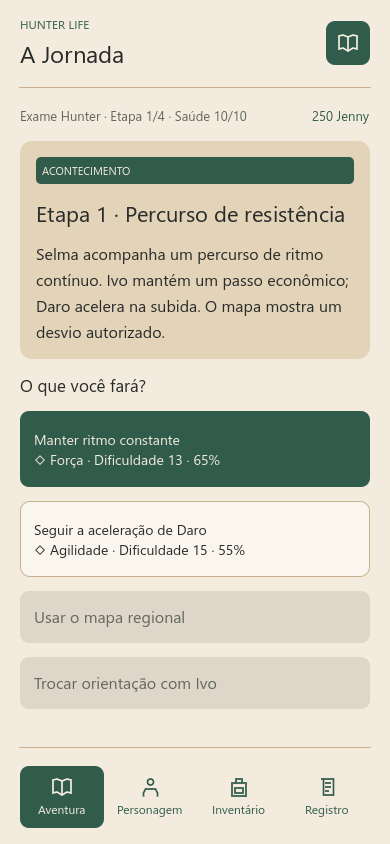
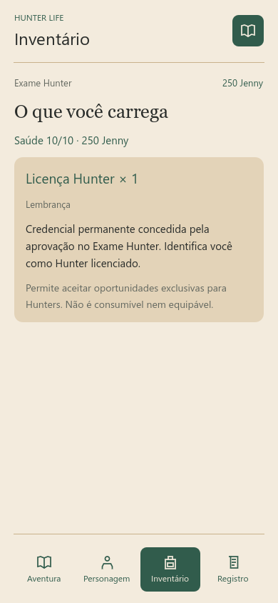

# Etapa 9 — Exame Hunter

## Entrega

Implementação no projeto existente, com Godot 4.7.2 e GDScript. O catálogo passou de **39 para 58 acontecimentos**, com **19 adições**, preservando o conteúdo anterior. A interface mantém as quatro abas e o visual de diário de explorador. A Etapa 10 não foi iniciada.

O Exame Hunter é uma aventura opcional, com uma participação por jornada. Inscrição, investigação prévia, adiamento e recusa estão disponíveis, sem requisito de nível, Nen ou Hatsu. Uma consulta na aba Personagem permite reencontrar a inscrição depois de conhecer a oportunidade, desde que não exista outra aventura ou batalha ativa.

## Provas e sorteio

No início da participação, o RNG persistente escolhe uma prova de cada par. As quatro escolhas são armazenadas; carregar não sorteia novamente. São **16 combinações** possíveis de textos previamente escritos.

| Etapa | Alternativa A | Alternativa B |
|---|---|---|
| 1 | Travessia perigosa: obstáculos, corda, apoio de Nara e proteção contextual de Ten | Percurso de resistência: ritmo, atalhos, mapa e orientação de Ivo |
| 2 | Investigação: pistas, entrevistas e regras contra fraude | Captura: planejamento, perseguição, discrição e alvo pequeno |
| 3 | Sobrevivência: caminhos, lanterna, bandagem e ajuda a outro candidato | Desafio coletivo: negociação, força e divisão de responsabilidades |
| 4 | Confronto individual com avaliação de conduta | Prova de decisão e interpretação das regras |

As continuações obrigatórias usam a prioridade narrativa existente. Três intervalos permitem consultar recursos, usar consumíveis fora de combate, prosseguir ou desistir. Falhas comuns podem causar dano e advertências, sem eliminação imediata.

Os examinadores originais são **Selma e Rui**. Os candidatos recorrentes são **Nara**, cooperativa; **Daro**, competitivo; e **Ivo**, pragmático. Flags registram ajuda e acordos, sem acrescentar relações numéricas ou NPCs autônomos.

## Resultados e recompensas

- A avaliação final aceita até duas advertências acumuladas; fraude ou sabotagem podem reprovar imediatamente.
- A prova de decisão combina o desempenho anterior com a alternativa escolhida; uma proposta própria também pode exigir teste.
- No confronto, vencer ou obter desistência do adversário permite aprovação com até duas advertências. A rendição do jogador pode ser aceita após ao menos um turno resolvido, com ajuda anterior a Nara e no máximo uma advertência. Essas condições são anunciadas na narrativa.
- Fuga ou rendição sem essas condições reprovam. Desistência explícita encerra somente a participação.
- Aprovação, reprovação e desistência retornam à jornada. Saúde zero mantém o encerramento por incapacidade já existente, sem morte automática.
- O XP legitimamente recebido permanece após reprovação. Provas comuns concedem, em geral, 14 XP por sucesso ou 5 por dificuldade; os valores ficam no JSON. O duelo possui recompensas próprias, sem dinheiro automático.
- Abrir o resultado de aprovação concede uma única **Licença Hunter** e **40 XP** definidos no catálogo. O marcador `awarded` impede duplicação. Carregar não reaplica essa operação.

A licença é o nono item do catálogo: única, permanente, não consumível e não equipável. Sua posse aparece no Inventário e o status em Personagem. Ela desbloqueia um contrato civil exclusivo de levantamento de rota: sucesso pode render 45 Jenny e 18 XP; fracasso relevante, 6 XP. Não concede atributos ou Nen.

## Integração existente

As escolhas usam as condições de atributos, itens, flags, técnicas e especializações já disponíveis. Corda e mapa oferecem caminhos contextuais; lanterna auxilia a travessia; doar uma bandagem consome exatamente uma unidade e registra ajuda. Há alternativas de Ten, Zetsu, Ren, Corpo Temperado/Potência e Projétil de Aura/Precisão. Os demais efeitos de Nen, Hatsus e equipamentos continuam disponíveis no combate, conforme suas regras anteriores.

O novo adversário Daro reutiliza o comportamento adaptativo do lutador, com 7 de Saúde e dificuldade base 14. Não houve alteração numérica global dos adversários anteriores. Os textos de intenção foram revisados para descrever postura e movimentos observáveis, removendo recomendações explícitas de estratégia.

## Salvamento v9

O estado novo é um dicionário `exam`:

```json
{
  "status": "unentered",
  "sequence": [],
  "stage": 0,
  "setbacks": 0,
  "awarded": false
}
```

Após inscrição, `sequence` contém quatro IDs válidos, `stage` fica entre 1 e 4 e `status` passa por `active`, `approved`, `failed` ou `withdrawn`. Decisões dos candidatos usam as flags narrativas existentes. Inventário, batalha, RNG, escolhas resolvidas e próxima continuação continuam no formato dos respectivos sistemas.

A migração de v8 inicializa participação vazia, sem conceder licença, resultados ou XP retroativos. As migrações anteriores permanecem disponíveis. Carregar não sobrescreve automaticamente o arquivo antigo. Estados inconsistentes, incluindo licença sem aprovação, prova ativa depois da eliminação e sequência incompatível com a etapa, são recusados.

Foram verificados salvamentos antes da chegada, durante provas, depois de decidir continuar um intervalo, durante o duelo, após aprovação e por incapacidade. Um estado aprovado ainda pode estar entre a decisão final e a abertura do resultado; nesse caso, a recompensa permanece pendente até a continuação normal, sem ser executada pelo carregamento.

## Arquivos

### Criados

- `scripts/exam.gd` e identificador `.uid`: estado, transições, avaliação, recompensa e validação.
- `tests/test_exam.gd` e `.uid`: testes funcionais, persistência e simulações.
- `tests/test_exam_visual.gd` e `.uid`: navegação renderizada e capturas.
- `STAGE_9.md`: este relatório.
- Sete imagens `tests/captures/exam_*.png`.

### Modificados

- `data/events.json`: 19 acontecimentos e suas consequências.
- `data/items.json`: Licença Hunter.
- `scripts/game_state.gd`: integração das transições e serialização v9.
- `scripts/catalog.gd`: condição por estado do exame.
- `scripts/storage.gd`: migração e validação v9.
- `scripts/inventory.gd`: permanência da licença.
- `scripts/battle.gd`: candidato, avaliação final e textos de intenção.
- `scripts/main.gd`: informações do exame, inscrição e status de Hunter.
- `project.godot`: identificação `0.9.0-prototype`.
- `tests/test_foundation.gd`, `tests/test_inventory.gd`, `tests/test_narrative.gd`: contagens esperadas atualizadas.
- `README.md`: reescrito como apresentação do estado atual, com instruções e links aos relatórios históricos.
- Capturas anteriores foram atualizadas pela execução das suítes visuais. Os relatórios `STAGE_4.md` a `STAGE_8.md` foram preservados.

## Testes executados

Importação pelo editor e execução normal no Godot 4.7.2 concluíram sem erros ou avisos de scripts nos logs. As **18 suítes** abaixo totalizam **15.180 verificações, zero falhas**:

| Suíte | Verificações |
|---|---:|
| Fundação | 41 |
| Motor narrativo | 1.280 |
| Continuidade de interface | 26 |
| Jornadas | 237 |
| Progressão | 430 |
| Interface de progressão | 4 |
| Nen | 1.239 |
| Hatsu | 218 |
| Batalhas | 7.793 |
| Textos apresentados ao jogador | 78 |
| Inventário | 528 |
| Interface geral | 348 |
| Interface Nen | 34 |
| Interface Hatsu | 180 |
| Interface batalhas | 68 |
| Interface inventário | 35 |
| Exame funcional | 2.603 |
| Interface exame | 38 |

Logs: `tests/stage9_*.log`. As suítes visuais foram executadas com renderização real; produziram **87 capturas no total**, incluindo sete novas do exame. Resoluções: 320×480, 390×844, 480×860, 768×1024 e 1100×720. Foram verificadas navegação, rolagem, cabeçalho de etapa, licença e status de Hunter, além da ausência de transbordamento horizontal. As capturas da prova em 390×844 e da licença também foram inspecionadas visualmente.

### Simulações e interpretação

- **300 participações com sementes distintas:** todas as 16 combinações apareceram. Política básica sem Nen: primeira alternativa de cada prova, ajuda inicial a Nara e, no duelo, defender uma vez e render-se. Resultados: **249 aprovações (83%) e 51 reprovações (17%)**. Essa é uma política específica e explora a condição explícita de cooperação/rendição; não representa a taxa de aprovação de qualquer estilo de jogo.
- **100 jornadas completas adicionais:** 50 ignorando o exame permaneceram sem participação; 50 com decisões aleatórias resultaram em 48 desistências e duas reprovações. Como a política aleatória também seleciona desistir nos intervalos, esse resultado verifica saídas e continuidade, e não estima dificuldade. Todas chegaram a final narrativo ou incapacidade sem bloqueio.
- **100 jornadas da regressão anterior:** encerraram normalmente, com no máximo 38 escolhas.
- **Regressão de batalhas:** o assaltante contra ataque básico manteve média de 2,365 turnos; o lutador contra política tática, 4,085. Defesa repetida não tornou o personagem imortal. Não foi ajustado o balanceamento global.
- Persistência verificou igualdade do estado e RNG antes/depois de carregar e resolver a mesma ação no duelo. Reabrir a aprovação não duplicou licença ou XP.

### Falhas encontradas e corrigidas durante a implementação

1. A conclusão do duelo tinha uma chamada adicional indevida de avaliação: foi centralizada no encerramento da batalha.
2. A incapacidade durante o exame precisava limpar a continuação pendente, preservando o contrato anterior de Saúde zero.
3. Um intervalo já resolvido incrementa a etapa antes de abrir a prova seguinte; a validação agora reconhece esse estado intermediário legítimo sem aceitar uma prova incompatível.

As suítes foram reexecutadas depois das correções e passaram. Os testes usam arquivos temporários próprios, sem substituir o salvamento manual do jogador.

## Capturas





Outras resoluções e a tela Personagem estão em `tests/captures/exam_*.png`.

## Limitações conhecidas

Uma participação por jornada, sem calendário ou exames anuais. As provas são curtas, com advertências compartilhadas como abstração de desempenho; não simulam pontuação detalhada de cada candidato. O duelo reutiliza um comportamento existente. O catálogo exclusivo de licenciados contém uma oportunidade. A amostra de 300 sementes confirma variedade e viabilidade sem Nen, mas não substitui avaliação humana prolongada de dificuldade e qualidade narrativa.

Não foram introduzidos novos Hatsus, relações numéricas, IA autônoma, mundo aberto ou sistemas da Etapa 10. Não há falhas críticas conhecidas nos fluxos testados.
